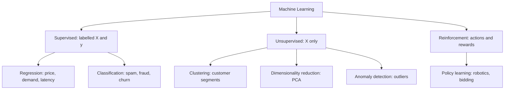
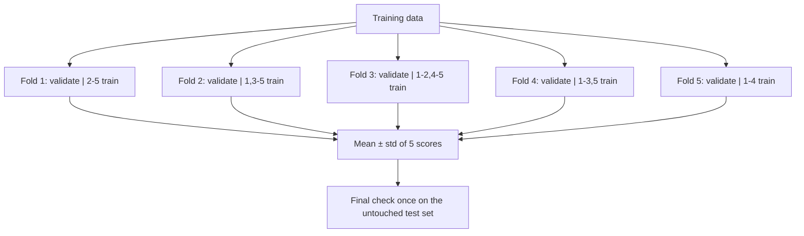
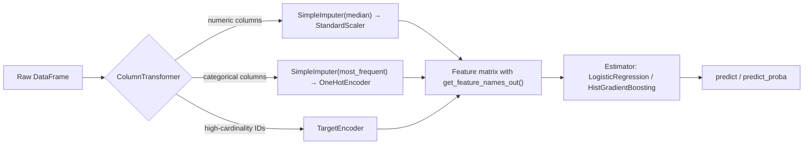
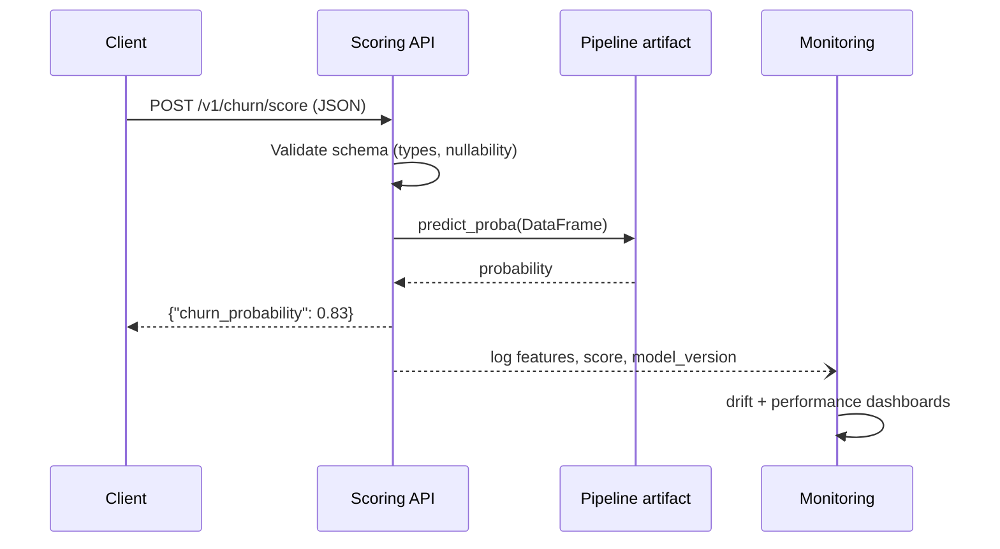
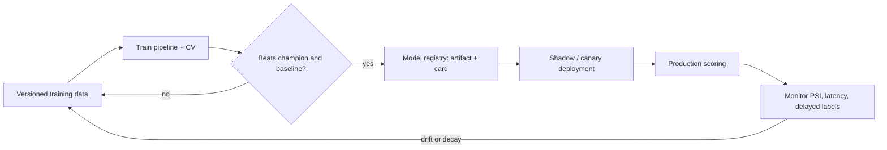

# Learn Machine Learning 🤖

<div align="center">

[](https://opensource.org/licenses/MIT)
[](https://www.python.org/)
[](https://scikit-learn.org/)
[](https://pandas.pydata.org/)
[](https://numpy.org/)
[](https://github.com/TheLearningHubOrg/learn-machine-learning)

**An exhaustive, production-grade masterclass from absolute zero to staff-level machine learning engineering.**  
Master supervised and unsupervised learning, feature engineering, leakage-proof validation, model evaluation and calibration, hyperparameter search, and scikit-learn pipelines that ship to production intact.

[Getting Started](#1-stage-1-absolute-beginner-foundations--the-learning-problem) • [Supervised Learning](#2-stage-2-supervised-learning-regression--classification) • [Feature Engineering](#3-stage-3-feature-engineering--data-preparation) • [Model Evaluation](#4-stage-4-model-evaluation-validation--calibration) • [Unsupervised Learning](#5-stage-5-unsupervised-learning-clustering-dimensionality-reduction--anomalies) • [Pipelines & Production](#6-stage-6-scikit-learn-pipelines-tuning--production-deployment) • [Staff Handbook](#7-stage-7-staff-machine-learning-engineer-interview-handbook--cheatsheet)

<br/>

<a href="https://www.buymeacoffee.com/manthanank">
  
</a>

</div>

---

## 🗺️ 7-Stage Pedagogical Roadmap


| Stage | Domain Focus | Core Concepts & Production Outcomes |
| :--- | :--- | :--- |
| **Stage 1** | **Absolute Beginner Foundations & the Learning Problem** | Learned functions vs hand-written rules, supervised/unsupervised/reinforcement paradigms, the `fit`/`predict`/`transform` contract, hyperparameters vs learned `coef_`-style attributes, a first `KNeighborsClassifier` end to end. |
| **Stage 2** | **Supervised Learning: Regression & Classification** | Least squares and the MSE loss, `Ridge`/`Lasso`/`ElasticNet` regularisation, `LogisticRegression` with `C` and `l1_ratio`, decision trees, `RandomForestClassifier`, `HistGradientBoostingClassifier`, k-NN and `SVC`, algorithm selection. |
| **Stage 3** | **Feature Engineering & Data Preparation** | Leakage-proof splits, `SimpleImputer(add_indicator=True)`, `OneHotEncoder` with infrequent buckets, `TargetEncoder` cross-fitting, scalers and power transforms, `SplineTransformer`, `FunctionTransformer`, `SelectFromModel` and `RFECV`. |
| **Stage 4** | **Model Evaluation, Validation & Calibration** | `DummyClassifier` baselines, `StratifiedKFold`/`GroupKFold`/`TimeSeriesSplit`, confusion matrices, precision/recall/F1, ROC AUC vs average precision, RMSE/MAE/R², learning curves, `TunedThresholdClassifierCV`, `CalibratedClassifierCV`. |
| **Stage 5** | **Unsupervised Learning: Clustering, Dimensionality Reduction & Anomalies** | `KMeans` with elbow and silhouette, `DBSCAN` and `HDBSCAN` for arbitrary shapes, agglomerative clustering, `PCA` with explained variance, t-SNE caveats, `IsolationForest`, ARI and silhouette metrics. |
| **Stage 6** | **scikit-learn Pipelines, Tuning & Production Deployment** | `Pipeline` + `ColumnTransformer`, `set_output(transform="pandas")`, `GridSearchCV`/`RandomizedSearchCV`/halving search, nested CV, custom transformers, permutation importance, `joblib` and `skops` persistence, drift monitoring with PSI, multi-stage Docker. |
| **Stage 7** | **Staff Machine Learning Engineer Interview Handbook** | 40 staff-level scenario Q&As on leakage, imbalance, calibration, drift, offline/online skew, tuning budgets and failure triage, plus an enterprise cheatsheet. |

---

## 📋 Table of Contents
- [1. Stage 1: Absolute Beginner Foundations & the Learning Problem](#1-stage-1-absolute-beginner-foundations--the-learning-problem)
  - [1.1 What Machine Learning Actually Is](#11-what-machine-learning-actually-is)
  - [1.2 The Three Learning Paradigms](#12-the-three-learning-paradigms)
  - [1.3 Environment Setup & the Companion Project](#13-environment-setup--the-companion-project)
  - [1.4 The scikit-learn Estimator API](#14-the-scikit-learn-estimator-api)
  - [1.5 Your First Model End to End](#15-your-first-model-end-to-end)
- [2. Stage 2: Supervised Learning: Regression & Classification](#2-stage-2-supervised-learning-regression--classification)
  - [2.1 Linear Regression & the Loss Function](#21-linear-regression--the-loss-function)
  - [2.2 Regularisation: Ridge, Lasso & Elastic Net](#22-regularisation-ridge-lasso--elastic-net)
  - [2.3 Logistic Regression & Decision Boundaries](#23-logistic-regression--decision-boundaries)
  - [2.4 Trees, Random Forests & Gradient Boosting](#24-trees-random-forests--gradient-boosting)
  - [2.5 Distance & Margin Models: k-NN and SVMs](#25-distance--margin-models-k-nn-and-svms)
  - [2.6 Choosing an Algorithm](#26-choosing-an-algorithm)
- [3. Stage 3: Feature Engineering & Data Preparation](#3-stage-3-feature-engineering--data-preparation)
  - [3.1 Train/Test Splits & Data Leakage](#31-traintest-splits--data-leakage)
  - [3.2 Missing Values & Imputation](#32-missing-values--imputation)
  - [3.3 Encoding Categorical Features](#33-encoding-categorical-features)
  - [3.4 Scaling & Transforming Numeric Features](#34-scaling--transforming-numeric-features)
  - [3.5 Creating Features: Ratios, Splines & Interactions](#35-creating-features-ratios-splines--interactions)
  - [3.6 Feature Selection](#36-feature-selection)
- [4. Stage 4: Model Evaluation, Validation & Calibration](#4-stage-4-model-evaluation-validation--calibration)
  - [4.1 Baselines First](#41-baselines-first)
  - [4.2 Cross-Validation Strategies](#42-cross-validation-strategies)
  - [4.3 Classification Metrics](#43-classification-metrics)
  - [4.4 Regression Metrics](#44-regression-metrics)
  - [4.5 Bias-Variance, Learning & Validation Curves](#45-bias-variance-learning--validation-curves)
  - [4.6 Decision Thresholds & Probability Calibration](#46-decision-thresholds--probability-calibration)
- [5. Stage 5: Unsupervised Learning: Clustering, Dimensionality Reduction & Anomalies](#5-stage-5-unsupervised-learning-clustering-dimensionality-reduction--anomalies)
  - [5.1 k-Means & Choosing k](#51-k-means--choosing-k)
  - [5.2 Density & Hierarchical Clustering](#52-density--hierarchical-clustering)
  - [5.3 Dimensionality Reduction: PCA & Embeddings](#53-dimensionality-reduction-pca--embeddings)
  - [5.4 Anomaly Detection](#54-anomaly-detection)
  - [5.5 Evaluating Clusters Without Labels](#55-evaluating-clusters-without-labels)
- [6. Stage 6: scikit-learn Pipelines, Tuning & Production Deployment](#6-stage-6-scikit-learn-pipelines-tuning--production-deployment)
  - [6.1 Pipeline & ColumnTransformer Architecture](#61-pipeline--columntransformer-architecture)
  - [6.2 Hyperparameter Search: Grid, Random & Halving](#62-hyperparameter-search-grid-random--halving)
  - [6.3 Custom Transformers](#63-custom-transformers)
  - [6.4 Interpretability: Permutation Importance & Partial Dependence](#64-interpretability-permutation-importance--partial-dependence)
  - [6.5 Persistence, Versioning & Serving](#65-persistence-versioning--serving)
  - [6.6 Monitoring Drift & Retraining](#66-monitoring-drift--retraining)
  - [6.7 Containerising the Trainer](#67-containerising-the-trainer)
- [7. Stage 7: Staff Machine Learning Engineer Interview Handbook & Cheatsheet](#7-stage-7-staff-machine-learning-engineer-interview-handbook--cheatsheet)
  - [7.1 Enterprise Production Cheatsheet](#71-enterprise-production-cheatsheet)
  - [7.2 Staff & Principal Architect Interview Q&A (40 Scenarios)](#72-staff--principal-architect-interview-qa-40-scenarios)
- [🤝 Contributing](#-contributing)
- [📄 License](#-license)

---

## 1. Stage 1: Absolute Beginner Foundations & the Learning Problem

### 1.1 What Machine Learning Actually Is

Traditional software encodes knowledge as rules a developer writes by hand: `if amount > 10_000 and country != home_country: flag()`. Machine learning flips that relationship. You supply **examples** (inputs paired with outcomes) and an **algorithm** searches a family of functions for the one that best maps inputs to outcomes. The result is a **model**: a function with parameters that were *fitted* rather than typed.

Formally, given a dataset of $n$ examples $\{(x_i, y_i)\}_{i=1}^{n}$, learning means choosing parameters $\theta$ so that a model $\hat{y} = f(x; \theta)$ minimises an average loss:

$$\theta^{*} = \arg\min_{\theta} \frac{1}{n} \sum_{i=1}^{n} L\big(y_i, f(x_i; \theta)\big) + \lambda \, \Omega(\theta)$$

The first term rewards fitting the data; the second term $\Omega(\theta)$ is a **regulariser** that penalises complexity so the model generalises to examples it has never seen. Almost every algorithm in this guide is a different choice of $f$, $L$ and $\Omega$.

```
Rules-based system                       Machine learning system
-------------------                      -----------------------
 data + rules  --->  answers              data + answers  --->  rules (model)
                                          model + new data --->  answers
```

Three vocabulary items appear everywhere:

1. **Features ($X$):** the measurable inputs, arranged as a 2-D table of shape $n\_samples \times n\_features$.
2. **Target ($y$):** the value to predict. Continuous targets make a **regression** problem; discrete labels make a **classification** problem.
3. **Generalisation:** performance on *unseen* data. Training accuracy is cheap; held-out accuracy is the only number that matters.

### 1.2 The Three Learning Paradigms



1. **Supervised learning** learns from labelled pairs. It dominates industry because most business questions ("will this customer churn?", "what will this house sell for?") have historical answers you can train on.
2. **Unsupervised learning** finds structure in unlabelled data: groups, low-dimensional summaries and points that do not fit the pattern.
3. **Reinforcement learning** trains an agent that acts in an environment and receives rewards. It is outside the scope of scikit-learn and of this guide.

There are also hybrids. **Semi-supervised** learning combines a few labels with many unlabelled rows, and **self-supervised** learning invents labels from the data itself, which is how large language models are pre-trained.

### 1.3 Environment Setup & the Companion Project

The repository ships a small, tested Python package under `src/mlguide` that implements every core pattern from this guide on scikit-learn's bundled datasets, so nothing needs to be downloaded.

```bash
# 1. Clone and create an isolated environment
git clone https://github.com/TheLearningHubOrg/learn-machine-learning.git
cd learn-machine-learning
python -m venv .venv
source .venv/bin/activate          # Windows: .venv\Scripts\activate

# 2. Install runtime dependencies plus pytest
pip install -r requirements-dev.txt

# 3. Run the test suite (14 behavioural checks)
pytest -q

# 4. Train every model and write artifacts plus a JSON report
PYTHONPATH=src python -m mlguide.train --out artifacts
```

```
learn-machine-learning/
├── src/mlguide/
│   ├── data.py        # dataset loaders, stratified split, synthetic churn table
│   ├── pipelines.py   # Pipeline and ColumnTransformer factories
│   ├── evaluate.py    # cross-validation, metrics, dummy baselines
│   ├── tuning.py      # GridSearchCV over a full pipeline
│   └── train.py       # end-to-end trainer and CLI
├── tests/test_models.py
├── Dockerfile
├── pyproject.toml
├── requirements.txt       # runtime dependencies (scikit-learn 1.8+)
└── requirements-dev.txt   # adds pytest
```

### 1.4 The scikit-learn Estimator API

scikit-learn's power comes from one consistent interface. Every object is an **estimator**, and estimators come in a few flavours:

| Role | Methods | Examples |
| :--- | :--- | :--- |
| **Transformer** | `fit`, `transform`, `fit_transform` | `StandardScaler`, `OneHotEncoder`, `PCA` |
| **Predictor** | `fit`, `predict`, often `predict_proba`, `score` | `LogisticRegression`, `RandomForestRegressor` |
| **Meta-estimator** | wraps other estimators | `Pipeline`, `GridSearchCV`, `CalibratedClassifierCV` |

Two conventions are worth memorising. **Hyperparameters** are constructor arguments you choose (`n_neighbors=5`). **Learned attributes** are set during `fit` and always end in an underscore (`mean_`, `coef_`, `classes_`), so an attribute with a trailing underscore tells you the estimator has been fitted.

```python
from sklearn.datasets import load_iris
from sklearn.neighbors import KNeighborsClassifier
from sklearn.preprocessing import StandardScaler

X, y = load_iris(return_X_y=True, as_frame=True)

# 1. Transformers learn state in fit() and apply it in transform()
scaler = StandardScaler().fit(X)
print("learned means:", scaler.mean_.round(2))
X_scaled = scaler.transform(X)

# 2. Predictors learn in fit() and answer in predict()
knn = KNeighborsClassifier(n_neighbors=5).fit(X_scaled, y)
print("predictions:", knn.predict(X_scaled[:3]))

# 3. Hyperparameters live in get_params(); learned state ends in "_"
print("k =", knn.get_params()["n_neighbors"], "| features seen:", knn.n_features_in_)
```

### 1.5 Your First Model End to End

The minimal honest workflow has five steps: load, split, fit, predict, evaluate on data the model never saw.

```python
from sklearn.datasets import load_iris
from sklearn.metrics import accuracy_score, classification_report
from sklearn.model_selection import train_test_split
from sklearn.neighbors import KNeighborsClassifier
from sklearn.pipeline import make_pipeline
from sklearn.preprocessing import StandardScaler

# 1. Load features and labels as pandas objects
X, y = load_iris(return_X_y=True, as_frame=True)

# 2. Hold out 25% for testing; stratify keeps the class ratio identical
X_train, X_test, y_train, y_test = train_test_split(
    X, y, test_size=0.25, stratify=y, random_state=42
)

# 3. Bundle scaling and the model so scaling is learned from training rows only
model = make_pipeline(StandardScaler(), KNeighborsClassifier(n_neighbors=7))
model.fit(X_train, y_train)

# 4. Predict and 5. evaluate on the untouched test set
pred = model.predict(X_test)
print(f"test accuracy: {accuracy_score(y_test, pred):.3f}")
print(classification_report(y_test, pred, target_names=["setosa", "versicolor", "virginica"]))
```

The `make_pipeline` call is the most important habit in this guide. Stage 3 shows what goes wrong without it.

---

## 2. Stage 2: Supervised Learning: Regression & Classification

### 2.1 Linear Regression & the Loss Function

Linear regression models the target as a weighted sum of features plus an intercept: $\hat{y} = w_0 + w_1 x_1 + \dots + w_p x_p$. Ordinary least squares chooses weights that minimise the **mean squared error**:

$$\text{MSE} = \frac{1}{n} \sum_{i=1}^{n} (y_i - \hat{y}_i)^2$$

Squaring makes the loss smooth and differentiable, so it has a closed-form solution, but it also means one row with a large error dominates the fit. When outliers are expected, `HuberRegressor` or a quantile loss is more robust.

```python
from sklearn.datasets import load_diabetes
from sklearn.linear_model import LinearRegression
from sklearn.metrics import root_mean_squared_error, r2_score
from sklearn.model_selection import train_test_split

X, y = load_diabetes(return_X_y=True, as_frame=True)
X_train, X_test, y_train, y_test = train_test_split(X, y, test_size=0.2, random_state=42)

ols = LinearRegression().fit(X_train, y_train)
pred = ols.predict(X_test)

# Coefficients are directly interpretable: change in y per unit change in x
coefs = dict(zip(X.columns, ols.coef_.round(1)))
print("largest effects:", sorted(coefs.items(), key=lambda kv: -abs(kv[1]))[:3])
print(f"RMSE={root_mean_squared_error(y_test, pred):.1f}  R2={r2_score(y_test, pred):.3f}")
```

### 2.2 Regularisation: Ridge, Lasso & Elastic Net

With many correlated features, least squares overfits: weights grow large and swing in opposite directions to cancel each other out. Regularisation adds a penalty on weight size.

1. **Ridge (L2):** adds $\alpha \sum w_j^2$. Shrinks every weight smoothly toward zero; keeps all features; stable under collinearity.
2. **Lasso (L1):** adds $\alpha \sum |w_j|$. Drives some weights to exactly zero, so it doubles as feature selection.
3. **Elastic Net:** blends both with `l1_ratio`. Useful when groups of correlated features exist and Lasso would pick one at random.

Penalties are scale-sensitive, so always standardise features before a regularised linear model.

```python
import numpy as np
from sklearn.datasets import load_diabetes
from sklearn.linear_model import ElasticNet, Lasso, Ridge
from sklearn.model_selection import cross_val_score
from sklearn.pipeline import make_pipeline
from sklearn.preprocessing import StandardScaler

X, y = load_diabetes(return_X_y=True, as_frame=True)

candidates = {
    "ridge": Ridge(alpha=10.0),
    "lasso": Lasso(alpha=2.0),
    "elastic": ElasticNet(alpha=0.5, l1_ratio=0.5),
}
for name, reg in candidates.items():
    pipe = make_pipeline(StandardScaler(), reg)
    rmse = -cross_val_score(pipe, X, y, cv=5, scoring="neg_root_mean_squared_error").mean()
    zeros = int(np.sum(pipe.fit(X, y)[-1].coef_ == 0))
    print(f"{name:8s} CV RMSE={rmse:6.1f}  zeroed coefficients={zeros}")
```

scikit-learn scorers follow a "greater is better" rule, which is why error metrics appear as `neg_root_mean_squared_error` and are negated back.

### 2.3 Logistic Regression & Decision Boundaries

Despite its name, logistic regression is a **classifier**. It computes a linear score $z = w^\top x + b$ and squashes it through the sigmoid $\sigma(z) = 1 / (1 + e^{-z})$ to get a probability. Training minimises **log loss**, which punishes confident wrong answers heavily:

$$\text{LogLoss} = -\frac{1}{n} \sum_{i=1}^{n} \big[ y_i \log p_i + (1 - y_i) \log(1 - p_i) \big]$$

In scikit-learn, `C` is the **inverse** regularisation strength: smaller `C` means a stronger penalty. Since release 1.8 the `penalty` argument is deprecated; the penalty type is controlled by `l1_ratio` (0 for pure L2, 1 for pure L1) together with `C`. On releases before 1.8, `l1_ratio` is ignored unless `penalty="elasticnet"` is set, so the L1 example below would quietly fit an L2 model; that is why this repository requires scikit-learn 1.8 or newer.

```python
from sklearn.datasets import load_breast_cancer
from sklearn.linear_model import LogisticRegression
from sklearn.metrics import log_loss, roc_auc_score
from sklearn.model_selection import train_test_split
from sklearn.pipeline import make_pipeline
from sklearn.preprocessing import StandardScaler

X, y = load_breast_cancer(return_X_y=True, as_frame=True)
X_train, X_test, y_train, y_test = train_test_split(X, y, stratify=y, random_state=42)

# 1. Default L2-regularised model
l2 = make_pipeline(StandardScaler(), LogisticRegression(C=1.0, max_iter=2_000))

# 2. Sparse L1 model: saga supports l1_ratio, and a small C forces sparsity
l1 = make_pipeline(
    StandardScaler(),
    LogisticRegression(C=0.1, l1_ratio=1.0, solver="saga", max_iter=20_000),
)

for name, model in {"l2": l2, "l1": l1}.items():
    model.fit(X_train, y_train)
    proba = model.predict_proba(X_test)[:, 1]
    kept = int((model[-1].coef_ != 0).sum())
    print(f"{name}: AUC={roc_auc_score(y_test, proba):.4f} "
          f"logloss={log_loss(y_test, proba):.4f} features kept={kept}/30")
```

For more than two classes, `LogisticRegression` fits a multinomial (softmax) model automatically with the default `lbfgs` solver.

### 2.4 Trees, Random Forests & Gradient Boosting

A **decision tree** splits the feature space with axis-aligned questions ("is `worst radius` > 16.8?") chosen to maximise purity (Gini impurity or entropy for classification, variance reduction for regression). Trees need no scaling, handle non-linear interactions natively, and are easy to read, but a single deep tree memorises noise.

Ensembles fix that in two different ways:

1. **Random forest (bagging):** trains hundreds of deep trees on bootstrap samples, each split considering a random subset of features, then averages. This lowers variance. It is hard to misconfigure.
2. **Gradient boosting:** trains shallow trees *sequentially*, each one fitting the residual errors of the ensemble so far, scaled by a `learning_rate`. This lowers bias. `HistGradientBoostingClassifier` bins features into histograms, which makes it fast on large tables, and it handles missing values and categorical dtypes natively.

```
Bagging (random forest)              Boosting (gradient boosting)
-----------------------              ----------------------------
 tree1  tree2  tree3 ... treeN        tree1 -> residuals -> tree2 -> residuals -> tree3
   \      |      |      /             prediction = sum(learning_rate * tree_k)
    average of votes                  each tree corrects the previous ones
 low variance, parallel               low bias, sequential, needs early stopping
```

```python
from sklearn.datasets import load_breast_cancer
from sklearn.ensemble import HistGradientBoostingClassifier, RandomForestClassifier
from sklearn.model_selection import StratifiedKFold, cross_val_score
from sklearn.tree import DecisionTreeClassifier

X, y = load_breast_cancer(return_X_y=True, as_frame=True)
cv = StratifiedKFold(n_splits=5, shuffle=True, random_state=0)

models = {
    "single tree": DecisionTreeClassifier(random_state=0),
    "pruned tree": DecisionTreeClassifier(max_depth=4, min_samples_leaf=5, random_state=0),
    "random forest": RandomForestClassifier(n_estimators=300, n_jobs=-1, random_state=0),
    "hist boosting": HistGradientBoostingClassifier(
        learning_rate=0.1, max_iter=300, early_stopping=True, random_state=0
    ),
}
for name, model in models.items():
    scores = cross_val_score(model, X, y, cv=cv, scoring="roc_auc")
    print(f"{name:14s} AUC {scores.mean():.4f} ± {scores.std():.4f}")
```

On tabular data of moderate size, gradient-boosted trees are usually the strongest single model family. The external libraries XGBoost, LightGBM and CatBoost implement the same idea with more knobs and GPU support.

### 2.5 Distance & Margin Models: k-NN and SVMs

1. **k-nearest neighbours** stores the training set and predicts by majority vote (or average) of the $k$ closest points. Training is free, prediction cost grows with data size, and it degrades in high dimensions because distances become uniform. Scaling is mandatory.
2. **Support vector machines** find the boundary with the widest margin between classes. The **kernel trick** (`kernel="rbf"`) lets them draw non-linear boundaries without building features explicitly. `C` trades margin width against training errors; `gamma` controls how local each support vector's influence is. Kernel SVMs scale roughly quadratically with rows, so they suit datasets up to tens of thousands of samples.

```python
from sklearn.datasets import load_wine
from sklearn.model_selection import cross_val_score
from sklearn.neighbors import KNeighborsClassifier
from sklearn.pipeline import make_pipeline
from sklearn.preprocessing import StandardScaler
from sklearn.svm import SVC

X, y = load_wine(return_X_y=True, as_frame=True)

for name, est in {
    "knn k=5": KNeighborsClassifier(n_neighbors=5),
    "svm rbf": SVC(kernel="rbf", C=3.0, gamma="scale"),
    "knn unscaled": None,
}.items():
    pipe = make_pipeline(KNeighborsClassifier(5)) if est is None else make_pipeline(StandardScaler(), est)
    print(f"{name:13s} accuracy {cross_val_score(pipe, X, y, cv=5).mean():.3f}")
```

The unscaled k-NN line shows the cost of skipping scaling: `proline` ranges into the thousands and swamps every other feature in the distance calculation.

### 2.6 Choosing an Algorithm

| Situation | Strong first choice | Why |
| :--- | :--- | :--- |
| Need a baseline in minutes | `LogisticRegression` / `Ridge` in a scaled pipeline | Fast, stable, interpretable coefficients |
| Tabular data, mixed types, non-linear | `HistGradientBoostingClassifier` / `Regressor` | Best accuracy per engineering hour; native NaN handling |
| Robust default with little tuning | `RandomForestClassifier` | Few sensitive hyperparameters, parallel |
| Strict interpretability or regulation | Shallow tree, linear model, or monotonic constraints | Explanations reviewers can audit |
| Small data, complex boundary | `SVC(kernel="rbf")` | Margin maximisation generalises well |
| Images, audio, free text | Deep learning (PyTorch, transformers) | Learned representations beat hand features |

---

## 3. Stage 3: Feature Engineering & Data Preparation

### 3.1 Train/Test Splits & Data Leakage

**Data leakage** occurs when information that would not be available at prediction time reaches the model during training. Validation scores become optimistic and the model fails in production. The most common source is fitting a preprocessing step (scaler, imputer, encoder, feature selector) on the full dataset before splitting.

```
LEAKY                                         CORRECT
-----                                         -------
 full data --fit scaler/selector-->           full data --split--> train | test
 transformed data --split--> train | test     train --fit pipeline (prep + model)
 test rows already influenced the prep        test --pipeline.transform/predict only
```

The demonstration below is the classic proof. The features are pure random noise, so no model should beat 50% accuracy. Selecting the "best" features on all rows before cross-validation makes noise look predictive.

```python
import numpy as np
from sklearn.feature_selection import SelectKBest, f_classif
from sklearn.linear_model import LogisticRegression
from sklearn.model_selection import cross_val_score
from sklearn.pipeline import make_pipeline

rng = np.random.default_rng(0)
X = rng.normal(size=(200, 5_000))          # 5,000 features of pure noise
y = rng.integers(0, 2, size=200)           # labels unrelated to X

# 1. LEAKY: feature selection sees every row, including future test folds
X_selected = SelectKBest(f_classif, k=20).fit_transform(X, y)
leaky = cross_val_score(LogisticRegression(max_iter=1_000), X_selected, y, cv=5).mean()

# 2. CORRECT: selection is refitted inside each training fold
pipe = make_pipeline(SelectKBest(f_classif, k=20), LogisticRegression(max_iter=1_000))
honest = cross_val_score(pipe, X, y, cv=5).mean()

print(f"leaky CV accuracy:  {leaky:.2f}   <- fantasy")
print(f"honest CV accuracy: {honest:.2f}   <- coin flip, as it should be")
```

Other leakage patterns to look for in review:

1. **Target leakage:** a feature that is a consequence of the label (for example `refund_issued` when predicting fraud).
2. **Temporal leakage:** random splits on time-ordered data let the model train on the future. Use `TimeSeriesSplit` or a cutoff date.
3. **Group leakage:** the same patient, user or device in both train and test. Use `GroupKFold`.
4. **Duplicate leakage:** near-identical rows across the split boundary, common after oversampling or data augmentation.

### 3.2 Missing Values & Imputation

Most estimators reject `NaN` (histogram gradient boosting is the notable exception). The choice of imputer matters less than two rules: fit it inside the pipeline, and keep a **missingness indicator** because the fact that a value is absent is often predictive by itself.

```python
import numpy as np
import pandas as pd
from sklearn.experimental import enable_iterative_imputer  # noqa: F401  (activates the API)
from sklearn.impute import IterativeImputer, KNNImputer, SimpleImputer

frame = pd.DataFrame(
    {
        "age": [34, np.nan, 51, 29, np.nan, 45],
        "income": [52_000, 61_000, np.nan, 38_000, 47_000, np.nan],
        "tenure": [3, 8, 12, 1, 4, 10],
    }
)

# 1. Median plus indicator columns: robust, fast, and keeps the missingness signal
simple = SimpleImputer(strategy="median", add_indicator=True).set_output(transform="pandas")
print(simple.fit_transform(frame).round(0))

# 2. KNN imputation borrows values from the most similar complete rows
print(KNNImputer(n_neighbors=2).fit_transform(frame).round(0))

# 3. Iterative imputation models each column from the others (MICE-style)
print(IterativeImputer(random_state=0, max_iter=50, tol=1e-2).fit_transform(frame).round(0))
```

### 3.3 Encoding Categorical Features

| Encoder | Output | Use when | Watch out for |
| :--- | :--- | :--- | :--- |
| `OneHotEncoder` | One binary column per category | Nominal categories, linear models | Column explosion on high cardinality; use `min_frequency` / `max_categories` |
| `OrdinalEncoder` | One integer column | Ordered categories, or any category with tree models | Implies an order linear models will take literally |
| `TargetEncoder` | Smoothed mean target per category | High-cardinality IDs (zip code, merchant) | Leaks unless cross-fitted; scikit-learn does this inside `fit_transform` |

```python
import pandas as pd
from sklearn.preprocessing import OneHotEncoder, OrdinalEncoder, TargetEncoder

train = pd.DataFrame(
    {
        "plan": ["basic", "premium", "basic", "standard", "basic", "enterprise"],
        "size": ["S", "L", "M", "M", "S", "XL"],
        "merchant": ["m1", "m2", "m1", "m3", "m4", "m2"],
    }
)
y = pd.Series([1, 0, 1, 0, 1, 0])

# 1. One-hot with an "infrequent" bucket and safe handling of unseen values
onehot = OneHotEncoder(
    min_frequency=2, handle_unknown="infrequent_if_exist", sparse_output=False
).set_output(transform="pandas")
print(onehot.fit_transform(train[["plan"]]))
print(onehot.transform(pd.DataFrame({"plan": ["trial"]})))   # unseen -> infrequent bucket

# 2. Explicit order so S < M < L < XL is preserved
ordinal = OrdinalEncoder(categories=[["S", "M", "L", "XL"]])
print(ordinal.fit_transform(train[["size"]]).ravel())

# 3. Target encoding with internal cross-fitting to avoid leakage
target = TargetEncoder(target_type="binary", cv=3)
print(target.fit_transform(train[["merchant"]], y).ravel().round(2))
```

Note that `TargetEncoder.fit_transform` is deliberately *not* equal to `fit(...).transform(...)`: the former uses out-of-fold estimates for training rows so each row never sees its own label.

### 3.4 Scaling & Transforming Numeric Features

Gradient-based and distance-based models (linear models, SVMs, k-NN, neural nets, PCA) are sensitive to feature scale. Trees are not.

| Transformer | What it does | Best for |
| :--- | :--- | :--- |
| `StandardScaler` | Subtract mean, divide by standard deviation | Default for linear models and SVMs |
| `MinMaxScaler` | Rescale to a fixed range such as [0, 1] | Bounded inputs, some neural nets |
| `RobustScaler` | Subtract median, divide by IQR | Heavy outliers |
| `PowerTransformer` | Yeo-Johnson / Box-Cox toward Gaussian | Skewed positive features |
| `QuantileTransformer` | Map to uniform or normal by rank | Extreme skew, multimodal data |
| `FunctionTransformer(np.log1p)` | Log compression | Counts, prices, durations |

```python
import numpy as np
import pandas as pd
from sklearn.preprocessing import PowerTransformer, RobustScaler, StandardScaler

rng = np.random.default_rng(1)
spend = pd.DataFrame({"spend": np.append(rng.lognormal(3, 1, 999), 50_000)})  # one whale

for scaler in (StandardScaler(), RobustScaler(), PowerTransformer()):
    out = scaler.fit_transform(spend).ravel()
    print(f"{type(scaler).__name__:17s} median={np.median(out):6.2f}  max={out.max():8.2f}")
```

The single outlier inflates the standard deviation, so `StandardScaler` squeezes every ordinary customer into a narrow band near zero. `RobustScaler` ignores the whale when choosing its scale, which keeps the bulk well spread (the whale itself stays extreme), and `PowerTransformer` compresses the tail so even the whale lands at a moderate value.

### 3.5 Creating Features: Ratios, Splines & Interactions

Good features encode domain knowledge the model would otherwise have to discover from limited data. Common high-value transforms are **ratios** (debt to income), **differences** (days since last order), **aggregates** (rolling 30-day spend per customer), **cyclical encodings** of time, and **non-linear expansions**.

```python
import numpy as np
import pandas as pd
from sklearn.compose import ColumnTransformer
from sklearn.preprocessing import FunctionTransformer, PolynomialFeatures, SplineTransformer


def add_ratios(df: pd.DataFrame) -> pd.DataFrame:
    """Domain features: charge per month of tenure and ticket intensity."""
    out = df.copy()
    out["charge_per_tenure"] = out["monthly_charge"] / out["tenure_months"].clip(lower=1)
    out["tickets_per_year"] = out["support_tickets"] / (out["tenure_months"] / 12).clip(lower=1 / 12)
    return out


def cyclical_hour(df: pd.DataFrame) -> pd.DataFrame:
    """Map hour 0-23 onto a circle so 23:00 and 00:00 are neighbours."""
    angle = 2 * np.pi * df["hour"] / 24
    return pd.DataFrame({"hour_sin": np.sin(angle), "hour_cos": np.cos(angle)})


frame = pd.DataFrame(
    {
        "tenure_months": [1, 24, 60],
        "monthly_charge": [80.0, 55.0, 99.0],
        "support_tickets": [3, 1, 0],
        "hour": [23, 0, 12],
    }
)

# add_ratios returns more columns than it receives, so no feature_names_out here:
# "one-to-one" would promise the input names and transform() would raise.
ratios = FunctionTransformer(add_ratios)
print(ratios.fit_transform(frame)[["charge_per_tenure", "tickets_per_year"]].round(2))

features = ColumnTransformer(
    [
        ("hour", FunctionTransformer(cyclical_hour), ["hour"]),
        ("tenure_spline", SplineTransformer(n_knots=4, degree=3), ["tenure_months"]),
        ("pairs", PolynomialFeatures(degree=2, interaction_only=True, include_bias=False),
         ["monthly_charge", "support_tickets"]),
    ]
)
print(features.fit_transform(frame).shape)
```

### 3.6 Feature Selection

Fewer features mean faster training, cheaper serving, less drift surface area and easier explanations. Three families exist:

1. **Filter methods:** score each feature independently (`mutual_info_classif`, `f_classif`, variance thresholds). Fast, but blind to interactions.
2. **Wrapper methods:** search subsets using a model (`RFECV`, `SequentialFeatureSelector`). Accurate, expensive.
3. **Embedded methods:** selection happens during training (L1 coefficients, tree importances) via `SelectFromModel`.

```python
from sklearn.datasets import load_breast_cancer
from sklearn.feature_selection import RFECV, SelectFromModel
from sklearn.linear_model import LogisticRegression
from sklearn.model_selection import StratifiedKFold
from sklearn.pipeline import make_pipeline
from sklearn.preprocessing import StandardScaler

X, y = load_breast_cancer(return_X_y=True, as_frame=True)

# 1. Embedded: keep features with non-zero L1 coefficients
l1 = LogisticRegression(C=0.1, l1_ratio=1.0, solver="saga", max_iter=20_000)
embedded = make_pipeline(StandardScaler(), SelectFromModel(l1)).fit(X, y)
print("L1 kept:", embedded[-1].get_support().sum(), "of", X.shape[1])

# 2. Wrapper: recursive elimination with cross-validated stopping point
rfecv = make_pipeline(
    StandardScaler(),
    RFECV(LogisticRegression(max_iter=2_000), step=2,
          cv=StratifiedKFold(5, shuffle=True, random_state=0), scoring="roc_auc"),
).fit(X, y)
print("RFECV optimum:", rfecv[-1].n_features_, "features")
```

As with every other step, selection must live inside the pipeline, as the leakage demonstration in 3.1 shows.

---

## 4. Stage 4: Model Evaluation, Validation & Calibration

### 4.1 Baselines First

Before celebrating 95% accuracy, ask what a model with no intelligence would score. On a dataset that is 95% negative, predicting "negative" every time scores exactly 95%. `DummyClassifier` and `DummyRegressor` put a floor under every result.

```python
from sklearn.datasets import load_breast_cancer
from sklearn.dummy import DummyClassifier
from sklearn.linear_model import LogisticRegression
from sklearn.model_selection import cross_val_score
from sklearn.pipeline import make_pipeline
from sklearn.preprocessing import StandardScaler

X, y = load_breast_cancer(return_X_y=True, as_frame=True)

for name, model in {
    "majority class": DummyClassifier(strategy="most_frequent"),
    "stratified guess": DummyClassifier(strategy="stratified", random_state=0),
    "logistic": make_pipeline(StandardScaler(), LogisticRegression(max_iter=2_000)),
}.items():
    acc = cross_val_score(model, X, y, cv=5, scoring="accuracy").mean()
    bal = cross_val_score(model, X, y, cv=5, scoring="balanced_accuracy").mean()
    print(f"{name:16s} accuracy={acc:.3f}  balanced accuracy={bal:.3f}")
```

### 4.2 Cross-Validation Strategies

A single train/test split gives one noisy estimate. **k-fold cross-validation** rotates the held-out fold so every row is used for validation exactly once, and the spread across folds tells you how much to trust the mean.



| Splitter | Guarantees | Use when |
| :--- | :--- | :--- |
| `KFold(shuffle=True)` | Random folds | Regression on i.i.d. rows |
| `StratifiedKFold` | Same class ratio in every fold | Any classification, essential for imbalance |
| `GroupKFold` / `StratifiedGroupKFold` | A group never spans train and validation | Multiple rows per user, patient, session |
| `TimeSeriesSplit` | Validation always after training in time | Forecasting, any temporal ordering |
| `RepeatedStratifiedKFold` | Several reshuffled k-fold runs | Small datasets with high score variance |

```python
import numpy as np
from sklearn.model_selection import GroupKFold, TimeSeriesSplit

X = np.arange(12).reshape(-1, 1)
groups = np.repeat(["u1", "u2", "u3", "u4"], 3)   # three rows per user

print("GroupKFold: no user appears on both sides")
for train_idx, val_idx in GroupKFold(n_splits=4).split(X, groups=groups):
    print("  validate on", sorted(set(groups[val_idx])), "train on", sorted(set(groups[train_idx])))

print("TimeSeriesSplit: validation always follows training")
for train_idx, val_idx in TimeSeriesSplit(n_splits=3, gap=1).split(X):
    print(f"  train {train_idx.min()}-{train_idx.max()}  gap  validate {val_idx.min()}-{val_idx.max()}")
```

The `gap` argument drops rows between train and validation, which matters when features use trailing windows that would otherwise overlap the validation period.

### 4.3 Classification Metrics

Every binary metric derives from the **confusion matrix**:

```
                    Predicted positive   Predicted negative
Actual positive     TP (hit)             FN (miss)
Actual negative     FP (false alarm)     TN (correct reject)
```

$$\text{Precision} = \frac{TP}{TP + FP} \qquad \text{Recall} = \frac{TP}{TP + FN} \qquad F_1 = 2 \cdot \frac{P \cdot R}{P + R}$$

1. **Precision** answers "when the model raises an alert, how often is it right?" It matters when false alarms are expensive (blocking a legitimate payment).
2. **Recall** answers "of all true positives, how many did we catch?" It matters when misses are expensive (missed cancer, missed fraud).
3. **ROC AUC** measures ranking quality across all thresholds. It can look excellent on heavily imbalanced data because the huge negative class inflates the true negative count.
4. **Average precision (PR AUC)** summarises the precision-recall curve and is the honest headline metric when positives are rare.
5. **Log loss** and **Brier score** judge the probabilities themselves, not just the ranking.

```python
from sklearn.datasets import make_classification
from sklearn.ensemble import HistGradientBoostingClassifier
from sklearn.metrics import (
    average_precision_score,
    brier_score_loss,
    classification_report,
    confusion_matrix,
    roc_auc_score,
)
from sklearn.model_selection import train_test_split

# 1. A 2% positive rate, typical of fraud or defect detection
X, y = make_classification(
    n_samples=20_000, n_features=20, n_informative=6, weights=[0.98], flip_y=0.01, random_state=7
)
X_train, X_test, y_train, y_test = train_test_split(X, y, stratify=y, random_state=7)

model = HistGradientBoostingClassifier(random_state=7).fit(X_train, y_train)
proba = model.predict_proba(X_test)[:, 1]
pred = (proba >= 0.5).astype(int)

# 2. ROC AUC looks great; average precision tells the real story
print(f"ROC AUC           {roc_auc_score(y_test, proba):.3f}")
print(f"Average precision {average_precision_score(y_test, proba):.3f}")
print(f"Brier score       {brier_score_loss(y_test, proba):.4f}")
print(confusion_matrix(y_test, pred))
print(classification_report(y_test, pred, digits=3))
```

For multiclass problems, choose the averaging deliberately: `macro` treats every class equally (good for spotting a neglected minority class), `weighted` follows class frequency, and `micro` equals accuracy for single-label problems.

### 4.4 Regression Metrics

| Metric | Formula sketch | Units | Character |
| :--- | :--- | :--- | :--- |
| **RMSE** | $\sqrt{\frac{1}{n}\sum (y - \hat{y})^2}$ | Target units | Penalises large errors; matches the MSE training loss |
| **MAE** | $\frac{1}{n}\sum \lvert y - \hat{y} \rvert$ | Target units | Robust to outliers; median-optimal |
| **MAPE** | $\frac{1}{n}\sum \lvert (y - \hat{y}) / y \rvert$ | Percent | Undefined near zero; biased toward under-prediction |
| **R²** | $1 - \frac{SS_{res}}{SS_{tot}}$ | Unitless | Share of variance explained; 0 equals predicting the mean |
| **Pinball loss** | Asymmetric absolute error | Target units | Evaluates quantile forecasts (P10, P90) |

```python
from sklearn.datasets import load_diabetes
from sklearn.dummy import DummyRegressor
from sklearn.ensemble import HistGradientBoostingRegressor
from sklearn.linear_model import RidgeCV
from sklearn.model_selection import cross_validate
from sklearn.pipeline import make_pipeline
from sklearn.preprocessing import StandardScaler

X, y = load_diabetes(return_X_y=True, as_frame=True)
scoring = {"rmse": "neg_root_mean_squared_error", "mae": "neg_mean_absolute_error", "r2": "r2"}

for name, model in {
    "mean baseline": DummyRegressor(),
    "ridge (CV alpha)": make_pipeline(StandardScaler(), RidgeCV(alphas=[0.1, 1, 10, 100])),
    "hist boosting": HistGradientBoostingRegressor(max_depth=3, learning_rate=0.05, random_state=0),
}.items():
    res = cross_validate(model, X, y, cv=5, scoring=scoring)
    print(f"{name:17s} RMSE={-res['test_rmse'].mean():6.1f} "
          f"MAE={-res['test_mae'].mean():6.1f} R2={res['test_r2'].mean():.3f}")
```

On this small, noisy dataset the regularised linear model edges out boosting. Model complexity has to be justified by data volume and signal.

### 4.5 Bias-Variance, Learning & Validation Curves

Prediction error splits into three parts: **bias** (the model family cannot express the truth), **variance** (the fit changes a lot with the sample), and **irreducible noise**.

```
Error
  |  \                                   /   total error
  |   \  bias^2                       /
  |    \____                       /  variance
  |         \______        ____/
  |                \______/  <- sweet spot
  +------------------------------------------- model complexity
     underfit                       overfit
```

Two diagnostic tools make this concrete:

1. A **validation curve** sweeps one hyperparameter and plots train vs validation score. A widening gap signals overfitting.
2. A **learning curve** sweeps training-set size. If validation score is still climbing at full size, more data will help; if train and validation have converged at a low score, you need a more expressive model or better features.

```python
import numpy as np
from sklearn.datasets import load_breast_cancer
from sklearn.model_selection import learning_curve, validation_curve
from sklearn.tree import DecisionTreeClassifier

X, y = load_breast_cancer(return_X_y=True)
tree = DecisionTreeClassifier(random_state=0)

# 1. Validation curve over tree depth
depths = [1, 2, 3, 4, 6, 8, 12, None]
train_s, val_s = validation_curve(tree, X, y, param_name="max_depth", param_range=depths, cv=5)
for d, tr, va in zip(depths, train_s.mean(1), val_s.mean(1)):
    print(f"depth={str(d):4s} train={tr:.3f} validation={va:.3f} gap={tr - va:.3f}")

# 2. Learning curve for a fixed depth
sizes, tr, va = learning_curve(
    DecisionTreeClassifier(max_depth=4, random_state=0), X, y,
    train_sizes=np.linspace(0.2, 1.0, 5), cv=5,
)
print("validation by size:", dict(zip(sizes, va.mean(1).round(3))))
```

### 4.6 Decision Thresholds & Probability Calibration

`predict()` on a binary classifier applies a fixed 0.5 cut-off to `predict_proba`. That is rarely the right business decision. Two separate concerns apply:

1. **Threshold tuning:** pick the cut-off that maximises the metric you actually care about, or minimises expected cost. `TunedThresholdClassifierCV` does this with cross-validation so the threshold is not overfitted to the test set.
2. **Calibration:** make a predicted 0.8 mean "80% of such cases are positive". Boosted trees, SVMs and naive Bayes are often miscalibrated. `CalibratedClassifierCV` fits a sigmoid (Platt) or isotonic mapping on held-out folds.

```python
from sklearn.calibration import CalibratedClassifierCV
from sklearn.datasets import make_classification
from sklearn.ensemble import HistGradientBoostingClassifier
from sklearn.metrics import brier_score_loss, f1_score, make_scorer
from sklearn.model_selection import TunedThresholdClassifierCV, train_test_split

X, y = make_classification(
    n_samples=8_000, weights=[0.95], n_informative=5, flip_y=0.02, random_state=1
)
X_train, X_test, y_train, y_test = train_test_split(X, y, stratify=y, random_state=1)
base = HistGradientBoostingClassifier(random_state=1)

# 1. Threshold chosen by cross-validated F1 instead of the default 0.5
tuned = TunedThresholdClassifierCV(base, scoring="f1", cv=5).fit(X_train, y_train)
default_f1 = f1_score(y_test, base.fit(X_train, y_train).predict(X_test))
print(f"threshold={tuned.best_threshold_:.2f}  F1 default={default_f1:.3f}  "
      f"F1 tuned={f1_score(y_test, tuned.predict(X_test)):.3f}")

# 2. Cost-sensitive threshold: a missed positive costs 10x a false alarm
def negative_cost(y_true, y_pred):
    fn = ((y_true == 1) & (y_pred == 0)).sum()
    fp = ((y_true == 0) & (y_pred == 1)).sum()
    return -(10 * fn + 1 * fp)

cost_tuned = TunedThresholdClassifierCV(base, scoring=make_scorer(negative_cost), cv=5)
print(f"cost-optimal threshold={cost_tuned.fit(X_train, y_train).best_threshold_:.2f}")

# 3. Isotonic calibration fitted on internal cross-validation folds
calibrated = CalibratedClassifierCV(base, method="isotonic", cv=5).fit(X_train, y_train)
print(f"Brier raw={brier_score_loss(y_test, base.predict_proba(X_test)[:, 1]):.4f}  "
      f"calibrated={brier_score_loss(y_test, calibrated.predict_proba(X_test)[:, 1]):.4f}")
```

To calibrate an already-fitted model on a separate holdout set, wrap it in `sklearn.frozen.FrozenEstimator`; the older `cv="prefit"` option was deprecated in 1.6 and current releases reject it.

---

## 5. Stage 5: Unsupervised Learning: Clustering, Dimensionality Reduction & Anomalies

### 5.1 k-Means & Choosing k

k-means places $k$ centroids and alternates two steps: assign each point to its nearest centroid, then move each centroid to the mean of its points. It minimises **inertia**, the within-cluster sum of squared distances:

$$\text{Inertia} = \sum_{i=1}^{n} \min_{j} \lVert x_i - \mu_j \rVert^2$$

It assumes roughly spherical, similarly sized clusters, needs scaled features, and you must choose $k$. Two common heuristics are the **elbow** in the inertia curve and the **silhouette score**, which compares each point's distance to its own cluster against the nearest other cluster (range $-1$ to $1$, higher is better).

```python
from sklearn.cluster import KMeans
from sklearn.datasets import make_blobs
from sklearn.metrics import silhouette_score
from sklearn.preprocessing import StandardScaler

X, _ = make_blobs(n_samples=1_500, centers=4, cluster_std=1.2, random_state=11)
X = StandardScaler().fit_transform(X)

for k in range(2, 8):
    km = KMeans(n_clusters=k, n_init="auto", random_state=11).fit(X)
    print(f"k={k}  inertia={km.inertia_:8.1f}  silhouette={silhouette_score(X, km.labels_):.3f}")
```

For datasets with millions of rows, `MiniBatchKMeans` trades a little quality for a large speed-up.

### 5.2 Density & Hierarchical Clustering

When clusters have irregular shapes or you do not know $k$, density-based methods are better suited.

1. **DBSCAN** groups points that have at least `min_samples` neighbours within radius `eps`, and labels everything else as noise (`-1`). It finds arbitrary shapes but one global `eps` struggles with clusters of varying density.
2. **HDBSCAN** builds a hierarchy over all density levels and extracts the most stable clusters, so it needs only `min_cluster_size`. It is usually the better default.
3. **Agglomerative clustering** merges the closest pairs bottom-up. The `linkage` choice (`ward`, `average`, `complete`, `single`) changes the shapes it prefers, and a dendrogram shows structure at every scale.

```python
from sklearn.cluster import DBSCAN, HDBSCAN, AgglomerativeClustering, KMeans
from sklearn.datasets import make_moons
from sklearn.metrics import adjusted_rand_score
from sklearn.preprocessing import StandardScaler

X, y_true = make_moons(n_samples=600, noise=0.06, random_state=5)
X = StandardScaler().fit_transform(X)

algorithms = {
    "k-means": KMeans(n_clusters=2, n_init="auto", random_state=5),
    "agglomerative (single)": AgglomerativeClustering(n_clusters=2, linkage="single"),
    "DBSCAN": DBSCAN(eps=0.3, min_samples=5),
    "HDBSCAN": HDBSCAN(min_cluster_size=20, copy=True),
}
for name, algo in algorithms.items():
    labels = algo.fit_predict(X)
    noise = int((labels == -1).sum())
    print(f"{name:23s} ARI={adjusted_rand_score(y_true, labels):.3f}  noise points={noise}")
```

k-means cuts the two interleaved moons with a straight line; the density and single-linkage methods follow the curves.

### 5.3 Dimensionality Reduction: PCA & Embeddings

**Principal component analysis** finds orthogonal directions of maximum variance and projects data onto the top few. It compresses correlated features, removes noise, speeds up downstream models and makes 2-D plots possible. Passing a float to `n_components` keeps just enough components to explain that fraction of variance.

```python
import numpy as np
from sklearn.datasets import load_breast_cancer
from sklearn.decomposition import PCA
from sklearn.linear_model import LogisticRegression
from sklearn.model_selection import cross_val_score
from sklearn.pipeline import make_pipeline
from sklearn.preprocessing import StandardScaler

X, y = load_breast_cancer(return_X_y=True)

# 1. How much variance do the first components capture?
pca = make_pipeline(StandardScaler(), PCA()).fit(X)
cumulative = np.cumsum(pca[-1].explained_variance_ratio_)
print("components for 95% variance:", int(np.searchsorted(cumulative, 0.95) + 1), "of", X.shape[1])

# 2. Use PCA as a compression step inside a supervised pipeline
compressed = make_pipeline(StandardScaler(), PCA(n_components=0.95), LogisticRegression(max_iter=2_000))
print(f"AUC with PCA(0.95): {cross_val_score(compressed, X, y, cv=5, scoring='roc_auc').mean():.4f}")
```

**t-SNE** (`sklearn.manifold.TSNE`) and **UMAP** (the external `umap-learn` package) produce striking 2-D maps that preserve local neighbourhoods. Treat them as visualisation only: distances between clusters and cluster sizes in the plot are not meaningful, results change with `perplexity` or `n_neighbors`, and t-SNE has no `transform` for new data.

### 5.4 Anomaly Detection

Anomaly detection flags rows that do not resemble the bulk of the data: fraud, sensor faults, intrusions, data-quality bugs.

1. **`IsolationForest`** builds random trees and measures how quickly a point is isolated. Outliers need fewer splits. It is fast and works in high dimensions.
2. **`LocalOutlierFactor`** compares a point's local density with its neighbours'. Use `novelty=True` to score new data.
3. **`OneClassSVM`** learns a boundary around normal data; it is sensitive to `nu` and `gamma` and scales poorly.

```python
import numpy as np
from sklearn.ensemble import IsolationForest

rng = np.random.default_rng(21)
normal = rng.normal(0, 1, size=(2_000, 4))
attacks = rng.uniform(5, 8, size=(20, 4))          # 1% injected anomalies
X = np.vstack([normal, attacks])
truth = np.r_[np.zeros(len(normal)), np.ones(len(attacks))]

detector = IsolationForest(n_estimators=300, contamination=0.01, random_state=21).fit(X)
flags = detector.predict(X) == -1                    # -1 marks an anomaly
scores = -detector.score_samples(X)                  # higher means more anomalous

caught = int(flags[truth == 1].sum())
print(f"flagged {flags.sum()} rows, caught {caught}/{len(attacks)} injected anomalies")
print("top-5 anomaly scores:", np.sort(scores)[-5:].round(3))
```

In production, prefer ranking by `score_samples` and setting an alert budget ("review the top 200 per day") over trusting a fixed `contamination` value.

### 5.5 Evaluating Clusters Without Labels

| Metric | Needs labels | Range | Reads as |
| :--- | :--- | :--- | :--- |
| **Silhouette** | No | -1 to 1 | Cohesion vs separation, higher is better |
| **Davies-Bouldin** | No | 0 to ∞ | Average similarity of each cluster to its closest neighbour, lower is better |
| **Calinski-Harabasz** | No | 0 to ∞ | Between- vs within-cluster dispersion, higher is better |
| **Adjusted Rand Index** | Yes | about -0.5 to 1 | Agreement with ground truth corrected for chance |
| **Normalised Mutual Information** | Yes | 0 to 1 | Shared information with ground truth |

Internal metrics share the geometric assumptions of k-means, so they favour convex clusters. The real test of a segmentation is whether the business can act on it: do segments differ on outcomes that matter, and are they stable when you re-run on next month's data?

---

## 6. Stage 6: scikit-learn Pipelines, Tuning & Production Deployment

### 6.1 Pipeline & ColumnTransformer Architecture

A production model is never just an estimator. It is the whole chain from raw columns to prediction, and that chain must be fitted, validated, versioned and deployed as **one object**. `ColumnTransformer` routes columns to type-specific preprocessing; `Pipeline` chains the preprocessing to the model.



```python
import numpy as np
import pandas as pd
from sklearn.compose import ColumnTransformer, make_column_selector
from sklearn.impute import SimpleImputer
from sklearn.linear_model import LogisticRegression
from sklearn.model_selection import train_test_split
from sklearn.pipeline import Pipeline
from sklearn.preprocessing import OneHotEncoder, StandardScaler

# 1. A small mixed-type table with gaps, like a real CRM export
rng = np.random.default_rng(0)
n = 500
X = pd.DataFrame(
    {
        "tenure_months": rng.integers(1, 72, n).astype(float),
        "monthly_charge": rng.normal(70, 20, n),
        "plan": rng.choice(["basic", "standard", "premium"], n),
        "region": rng.choice(["north", "south", "east", "west"], n),
    }
)
X.loc[rng.random(n) < 0.05, "monthly_charge"] = np.nan
y = ((X["tenure_months"] < 12) & (X["plan"] == "basic")).astype(int)

# 2. Type-routed preprocessing; dtype_exclude="number" also catches pandas 3 str columns
preprocess = ColumnTransformer(
    [
        ("num", Pipeline([("impute", SimpleImputer(strategy="median")),
                          ("scale", StandardScaler())]),
         make_column_selector(dtype_include="number")),
        ("cat", Pipeline([("impute", SimpleImputer(strategy="most_frequent")),
                          ("onehot", OneHotEncoder(handle_unknown="ignore", sparse_output=False))]),
         make_column_selector(dtype_exclude="number")),
    ],
    verbose_feature_names_out=False,
)

# 3. One object from raw columns to probabilities
model = Pipeline([("prep", preprocess), ("clf", LogisticRegression(max_iter=2_000))])
model.set_output(transform="pandas")

X_train, X_test, y_train, y_test = train_test_split(X, y, stratify=y, random_state=0)
model.fit(X_train, y_train)
print("test accuracy:", round(model.score(X_test, y_test), 3))
print("engineered features:", list(model[:-1].get_feature_names_out()))

# 4. Inspect any fitted step by name
print(model.named_steps["prep"].named_transformers_["num"]["impute"].statistics_.round(1))
```

The companion repository's `src/mlguide/pipelines.py` contains this pattern as `churn_pipeline()`, plus a `boosting_pipeline()` that skips numeric imputation because `HistGradientBoostingClassifier` handles `NaN` natively. `Pipeline(memory="cache_dir")` caches fitted transformers so a grid search does not refit expensive preprocessing for every model setting.

### 6.2 Hyperparameter Search: Grid, Random & Halving

Hyperparameters are tuned against cross-validation, never against the test set. Pipeline step parameters are addressed with double underscores: `prep__num__impute__strategy`, `clf__C`.

| Strategy | How it explores | Use when |
| :--- | :--- | :--- |
| `GridSearchCV` | Every combination | 1-3 parameters with a few values each |
| `RandomizedSearchCV` | Samples `n_iter` points from distributions | Many parameters; continuous ranges |
| `HalvingRandomSearchCV` | Many candidates on little data, survivors get more | Large search spaces, expensive fits |
| Bayesian (Optuna, scikit-optimize) | Models the score surface to pick the next trial | Expensive models where every trial counts |

```python
from scipy.stats import loguniform, randint
from sklearn.datasets import load_breast_cancer
from sklearn.ensemble import HistGradientBoostingClassifier
from sklearn.experimental import enable_halving_search_cv  # noqa: F401
from sklearn.model_selection import HalvingRandomSearchCV, RandomizedSearchCV, StratifiedKFold

X, y = load_breast_cancer(return_X_y=True)
cv = StratifiedKFold(n_splits=5, shuffle=True, random_state=0)

space = {
    "learning_rate": loguniform(0.01, 0.3),
    "max_leaf_nodes": randint(8, 64),
    "min_samples_leaf": randint(5, 50),
    "l2_regularization": loguniform(1e-4, 10),
}

# 1. Random search: a fixed budget of 20 sampled configurations
random_search = RandomizedSearchCV(
    HistGradientBoostingClassifier(random_state=0), space,
    n_iter=20, scoring="roc_auc", cv=cv, n_jobs=-1, random_state=0,
).fit(X, y)
print(f"random   best AUC={random_search.best_score_:.4f}")

# 2. Successive halving: start wide on few samples, promote the best
halving = HalvingRandomSearchCV(
    HistGradientBoostingClassifier(random_state=0), space,
    factor=3, min_resources=120, scoring="roc_auc", cv=cv, n_jobs=-1, random_state=0,
).fit(X, y)
print(f"halving  best AUC={halving.best_score_:.4f} after {halving.n_iterations_} rounds")
```

The best cross-validated score from a search is **optimistically biased**, because you picked the maximum of many noisy estimates. To report an unbiased number, use **nested cross-validation**: an outer loop for evaluation, an inner search for tuning.

```python
from sklearn.datasets import load_breast_cancer
from sklearn.linear_model import LogisticRegression
from sklearn.model_selection import GridSearchCV, StratifiedKFold, cross_val_score
from sklearn.pipeline import make_pipeline
from sklearn.preprocessing import StandardScaler

X, y = load_breast_cancer(return_X_y=True)
inner = StratifiedKFold(3, shuffle=True, random_state=1)
outer = StratifiedKFold(5, shuffle=True, random_state=2)

search = GridSearchCV(
    make_pipeline(StandardScaler(), LogisticRegression(max_iter=2_000)),
    {"logisticregression__C": [0.01, 0.1, 1, 10]},
    cv=inner, scoring="roc_auc",
)
nested = cross_val_score(search, X, y, cv=outer, scoring="roc_auc")
print(f"nested CV AUC {nested.mean():.4f} ± {nested.std():.4f}")
```

### 6.3 Custom Transformers

When built-in transformers are not enough, write your own by inheriting `BaseEstimator` and `TransformerMixin`. Follow the contract so cloning, grid search and persistence keep working:

1. `__init__` only stores arguments, unchanged, as attributes with the same names. No validation or computation.
2. `fit` learns state into attributes ending in `_` and returns `self`.
3. `transform` uses only fitted state and never looks at `y`.
4. Implement `get_feature_names_out` so downstream steps and `set_output` know the column names.

```python
import numpy as np
import pandas as pd
from sklearn.base import BaseEstimator, TransformerMixin, clone
from sklearn.utils.validation import check_is_fitted


class QuantileClipper(BaseEstimator, TransformerMixin):
    """Clip each numeric column to quantiles learned on the training data."""

    def __init__(self, lower=0.01, upper=0.99):
        self.lower = lower
        self.upper = upper

    def fit(self, X, y=None):
        frame = pd.DataFrame(X)
        self.low_ = frame.quantile(self.lower).to_numpy()
        self.high_ = frame.quantile(self.upper).to_numpy()
        self.n_features_in_ = frame.shape[1]
        if hasattr(X, "columns"):                 # only record names a DataFrame supplied
            self.feature_names_in_ = np.asarray(X.columns, dtype=object)
        return self

    def transform(self, X):
        check_is_fitted(self, ["low_", "high_"])
        values = np.asarray(X, dtype=float)
        if values.shape[1] != self.n_features_in_:
            raise ValueError(f"expected {self.n_features_in_} columns, got {values.shape[1]}")
        return np.clip(values, self.low_, self.high_)

    def get_feature_names_out(self, input_features=None):
        check_is_fitted(self, "n_features_in_")
        if input_features is not None:
            return np.asarray(input_features, dtype=object)
        if hasattr(self, "feature_names_in_"):
            return self.feature_names_in_
        return np.asarray([f"x{i}" for i in range(self.n_features_in_)], dtype=object)


train = pd.DataFrame({"latency_ms": [12, 15, 14, 13, 900], "payload_kb": [1, 2, 2, 3, 400]})
clipper = QuantileClipper(lower=0.0, upper=0.8).set_output(transform="pandas")
print(clipper.fit_transform(train))
print("clone keeps params:", clone(clipper).get_params())
```

`sklearn.utils.estimator_checks.check_estimator` runs scikit-learn's compliance suite against a custom estimator and is worth adding to the test suite of any shared transformer library.

### 6.4 Interpretability: Permutation Importance & Partial Dependence

Stakeholders, regulators and your own debugging all need to know *why* a model predicts what it does.

1. **Impurity-based importances** (`feature_importances_` on trees) are computed on training data and are biased toward high-cardinality features. Treat them as a rough hint.
2. **Permutation importance** shuffles one column at a time on held-out data and measures the score drop. It is model-agnostic and honest, but correlated features share credit, so each one alone can look unimportant.
3. **Partial dependence** and **ICE plots** (`PartialDependenceDisplay`) show how the prediction moves as one feature changes, averaged over the data or per row.
4. **SHAP values** (external `shap` package) attribute each individual prediction to its features additively, which is the usual tool for per-decision explanations.

```python
from sklearn.datasets import load_breast_cancer
from sklearn.ensemble import RandomForestClassifier
from sklearn.inspection import permutation_importance
from sklearn.model_selection import train_test_split

X, y = load_breast_cancer(return_X_y=True, as_frame=True)
X_train, X_test, y_train, y_test = train_test_split(X, y, stratify=y, random_state=0)
forest = RandomForestClassifier(n_estimators=300, n_jobs=-1, random_state=0).fit(X_train, y_train)

result = permutation_importance(
    forest, X_test, y_test, scoring="roc_auc", n_repeats=10, random_state=0, n_jobs=-1
)
ranking = sorted(zip(X.columns, result.importances_mean, result.importances_std), key=lambda r: -r[1])
for name, mean, std in ranking[:5]:
    print(f"{name:22s} {mean:.4f} ± {std:.4f}")
```

Run this and the scores come out tiny, with standard deviations larger than the means. That is the correlated-feature caveat in action: `worst radius`, `worst perimeter` and `worst area` carry almost the same information, so shuffling any one of them costs nothing while the others remain. Group correlated features (for example with hierarchical clustering on Spearman correlations) and permute each group together before drawing conclusions.

### 6.5 Persistence, Versioning & Serving

A fitted pipeline is serialised as a single artifact. `joblib` (pickle with efficient NumPy handling) is the standard; `skops.io` is a safer format that refuses to load untrusted types. **Never unpickle a file from an untrusted source**: loading a pickle can execute arbitrary code.

Pickled scikit-learn models are only guaranteed to load with the **same scikit-learn version** that wrote them, so store the environment alongside the artifact.

```python
import hashlib
import json
import platform
from pathlib import Path

import joblib
import sklearn
from sklearn.datasets import load_breast_cancer
from sklearn.linear_model import LogisticRegression
from sklearn.pipeline import make_pipeline
from sklearn.preprocessing import StandardScaler

X, y = load_breast_cancer(return_X_y=True, as_frame=True)
model = make_pipeline(StandardScaler(), LogisticRegression(max_iter=2_000)).fit(X, y)

out = Path("artifacts")
out.mkdir(exist_ok=True)
model_path = out / "cancer_model.joblib"

# 1. Persist the whole pipeline (preprocessing + model) as one file
joblib.dump(model, model_path, compress=3)

# 2. Write a model card with everything needed to reproduce and validate it
card = {
    "sklearn_version": sklearn.__version__,
    "python_version": platform.python_version(),
    "features": list(X.columns),
    "sha256": hashlib.sha256(model_path.read_bytes()).hexdigest(),
    "train_rows": len(X),
}
(out / "cancer_model.json").write_text(json.dumps(card, indent=2))

# 3. At load time, refuse a version mismatch instead of failing subtly
loaded_card = json.loads((out / "cancer_model.json").read_text())
assert loaded_card["sklearn_version"] == sklearn.__version__, "retrain or pin scikit-learn"
restored = joblib.load(model_path)
print("round-trip predictions match:", (restored.predict(X) == model.predict(X)).all())
```

Serving is then a thin wrapper. The sketch below uses FastAPI (install `fastapi` and `uvicorn` separately). It validates input with a schema, loads the model once at start-up, and builds a DataFrame with the training column order.

```python
from contextlib import asynccontextmanager

import joblib
import pandas as pd
from fastapi import FastAPI
from pydantic import BaseModel

state = {}


@asynccontextmanager
async def lifespan(app: FastAPI):
    state["model"] = joblib.load("artifacts/churn_logistic.joblib")
    yield
    state.clear()


app = FastAPI(lifespan=lifespan)


class Customer(BaseModel):
    tenure_months: float
    monthly_charge: float | None = None
    support_tickets: float
    plan: str
    region: str | None = None


@app.post("/v1/churn/score")
def score(customer: Customer) -> dict:
    frame = pd.DataFrame([customer.model_dump()])
    probability = float(state["model"].predict_proba(frame)[0, 1])
    return {"churn_probability": round(probability, 4), "model_version": "1.0.0"}
```



### 6.6 Monitoring Drift & Retraining

Models decay because the world changes. Three kinds of drift matter:

1. **Data (covariate) drift:** the input distribution $P(X)$ shifts, for example a new marketing channel brings younger customers.
2. **Concept drift:** the relationship $P(y \mid X)$ changes, for example fraudsters adapt to the model.
3. **Label or prior drift:** the base rate $P(y)$ moves, which silently breaks a tuned threshold.

Labels often arrive weeks late, so input drift is the early-warning signal. The **population stability index** compares binned distributions between a reference window and live traffic: below 0.1 is stable, 0.1 to 0.25 deserves a look, above 0.25 is a significant shift.

$$\text{PSI} = \sum_{b=1}^{B} (a_b - e_b) \ln\frac{a_b}{e_b}$$

```python
import numpy as np


def population_stability_index(expected, actual, bins: int = 10, eps: float = 1e-6) -> float:
    """PSI between a reference sample and a live sample using reference quantile bins."""
    expected = np.asarray(expected, dtype=float)
    actual = np.asarray(actual, dtype=float)
    edges = np.quantile(expected, np.linspace(0, 1, bins + 1))
    edges[0], edges[-1] = -np.inf, np.inf
    e_share = np.histogram(expected, edges)[0] / len(expected) + eps
    a_share = np.histogram(actual, edges)[0] / len(actual) + eps
    return float(np.sum((a_share - e_share) * np.log(a_share / e_share)))


rng = np.random.default_rng(4)
reference = rng.normal(50, 10, 10_000)            # training-time distribution
same = rng.normal(50, 10, 5_000)                  # healthy live traffic
shifted = rng.normal(58, 12, 5_000)               # a new customer segment arrives

print(f"PSI healthy: {population_stability_index(reference, same):.3f}")
print(f"PSI shifted: {population_stability_index(reference, shifted):.3f}")
```



A sensible retraining policy combines a **schedule** (monthly retrains from a rolling window), **triggers** (PSI or performance thresholds), and a **promotion gate** (the challenger must beat the current champion on a recent, time-ordered holdout before it takes traffic).

### 6.7 Containerising the Trainer

The repository's Dockerfile builds a slim, non-root image that runs the trainer and writes artifacts to a mounted volume. Only `requirements.txt` is installed, so pytest stays out of the runtime image.

```dockerfile
# Production Dockerfile for the Machine Learning companion trainer
FROM python:3.13-slim AS builder

RUN python -m venv /opt/venv
ENV PATH="/opt/venv/bin:$PATH"

COPY requirements.txt .
RUN pip install --no-cache-dir -r requirements.txt

FROM python:3.13-slim AS runner

ENV PATH="/opt/venv/bin:$PATH" \
    PYTHONDONTWRITEBYTECODE=1 \
    PYTHONUNBUFFERED=1 \
    PYTHONPATH=/app/src

RUN useradd --create-home --uid 10001 appuser     && mkdir -p /app/artifacts     && chown appuser:appuser /app/artifacts
WORKDIR /app
COPY --from=builder /opt/venv /opt/venv
COPY src ./src

USER appuser
# Trains every model, prints a JSON report and writes artifacts to /app/artifacts
CMD ["python", "-m", "mlguide.train", "--out", "/app/artifacts"]
```

```bash
# Build the image and run a training job with artifacts on the host.
# Create the host folder first and run as your own UID so the container can write to it.
docker build -t learn-ml-trainer .
mkdir -p artifacts
docker run --rm --user "$(id -u):$(id -g)" -v "$(pwd)/artifacts:/app/artifacts" learn-ml-trainer

# Inspect the evaluation report written by the job
cat artifacts/report.json
```

In a real platform, the same image runs as a scheduled job (Kubernetes CronJob, Airflow task, or a managed training service), with requirements pinned to exact versions through a lock file so the serving image loads the artifact with the identical scikit-learn build.

---

## 7. Stage 7: Staff Machine Learning Engineer Interview Handbook & Cheatsheet

### 7.1 Enterprise Production Cheatsheet

| Concern | Tool | Command / Pattern |
| :--- | :--- | :--- |
| Hold-out split | `train_test_split` | `train_test_split(X, y, stratify=y, test_size=0.2, random_state=42)` |
| Leakage-proof prep | `Pipeline` | `make_pipeline(StandardScaler(), LogisticRegression())` |
| Mixed column types | `ColumnTransformer` | `make_column_selector(dtype_include="number")` / `dtype_exclude="number"` |
| Pandas output | `set_output` | `pipe.set_output(transform="pandas")` |
| Missing values | `SimpleImputer` | `SimpleImputer(strategy="median", add_indicator=True)` |
| Unseen categories | `OneHotEncoder` | `OneHotEncoder(handle_unknown="infrequent_if_exist", min_frequency=20)` |
| High cardinality | `TargetEncoder` | `TargetEncoder(target_type="binary", cv=5)` |
| Baseline | `DummyClassifier` | `DummyClassifier(strategy="most_frequent")` |
| Imbalanced CV | `StratifiedKFold` | `StratifiedKFold(5, shuffle=True, random_state=0)` |
| Grouped rows | `GroupKFold` | `cross_val_score(pipe, X, y, groups=user_id, cv=GroupKFold(5))` |
| Temporal data | `TimeSeriesSplit` | `TimeSeriesSplit(n_splits=5, gap=7)` |
| Multi-metric CV | `cross_validate` | `cross_validate(pipe, X, y, scoring=["roc_auc", "average_precision"])` |
| Rare positives | metrics | `average_precision_score(y, proba)` over `roc_auc_score` |
| Regression error | metrics | `root_mean_squared_error(y, pred)` |
| Tuning (small grid) | `GridSearchCV` | `GridSearchCV(pipe, {"clf__C": [0.1, 1, 10]}, cv=cv)` |
| Tuning (large space) | `RandomizedSearchCV` | `RandomizedSearchCV(pipe, {"clf__C": loguniform(1e-3, 1e2)}, n_iter=50)` |
| Unbiased estimate | nested CV | `cross_val_score(GridSearchCV(...), X, y, cv=outer)` |
| Decision threshold | `TunedThresholdClassifierCV` | `TunedThresholdClassifierCV(clf, scoring="f1")` |
| Calibration | `CalibratedClassifierCV` | `CalibratedClassifierCV(clf, method="isotonic", cv=5)` |
| Explanations | `permutation_importance` | `permutation_importance(model, X_val, y_val, n_repeats=10)` |
| Clustering | `HDBSCAN` | `HDBSCAN(min_cluster_size=50).fit_predict(X_scaled)` |
| Compression | `PCA` | `PCA(n_components=0.95)` |
| Outliers | `IsolationForest` | `IsolationForest(contamination="auto").score_samples(X)` |
| Persistence | `joblib` / `skops` | `joblib.dump(pipe, "model.joblib")` plus a version card |
| Drift | PSI | `population_stability_index(train_col, live_col) > 0.25` |
| Run the guide | CLI | `PYTHONPATH=src python -m mlguide.train --out artifacts` |

### 7.2 Staff & Principal Architect Interview Q&A (40 Scenarios)

#### Q1: Your model scored 0.94 AUC offline but 0.71 in production a week after launch. How do you triage it?
> **Answer**: Work from cheapest to most expensive explanation. First check **training-serving skew**: log the exact feature vectors the service receives and compare them with offline features for the same entities. Mismatched units, a missing join that silently fills `NaN`, different category spellings, or a feature computed with future data offline are the usual culprits. Second, check for **leakage** in the offline setup: random splits on temporal data, group leakage, or a feature that is only populated after the label event. Re-run validation with a strict time-based split; if offline AUC also drops to the low 0.7s, the original number was never real. Third, check **population shift** with PSI per feature against the training window. Fix the root cause, then add a contract test that replays a sample of production requests through the offline feature pipeline and asserts parity.

#### Q2: Why must preprocessing be inside the Pipeline rather than applied before cross-validation?
> **Answer**: Any step with learned state (scaler means, imputer medians, encoder vocabularies, selected features, target encodings) fitted on all rows has seen the validation folds. The model is then evaluated on data that influenced its own preprocessing, which inflates scores. The effect ranges from negligible for a scaler on large data to severe for supervised steps such as `SelectKBest` or target encoding, where pure noise can appear highly predictive. Putting the steps in a `Pipeline` means `cross_validate` and `GridSearchCV` clone and refit the whole chain inside every training fold, and the same object is what gets serialised, so serving cannot drift from training.

#### Q3: You have a fraud dataset with 0.3% positives. Which metric do you report and why?
> **Answer**: Accuracy is meaningless because the all-negative model scores 99.7%. ROC AUC is also misleading because the false positive rate divides by a huge negative count, so thousands of false alarms barely move it. Report **average precision** (area under the precision-recall curve) as the ranking metric, and alongside it an operational metric tied to the decision: recall at a fixed review capacity ("we can investigate 500 cases a day") or precision at a target recall. Report confidence intervals via bootstrap or repeated stratified CV, because with few positives the metrics are noisy. Finally, translate to money with an expected-cost calculation, since that is how the threshold should be set.

#### Q4: When would you use class weights versus resampling for imbalance?
> **Answer**: Start with neither: train on the natural distribution, rank by probability and tune the threshold, because most strong learners rank well despite imbalance. If the minority class is under-fit, `class_weight="balanced"` (or `sample_weight`) reweights the loss without changing data, is cheap, and works inside any pipeline. Random undersampling of the majority helps when data is huge and training time matters. Synthetic oversampling (SMOTE from `imbalanced-learn`) is rarely worth it with gradient boosting and must happen inside the CV fold only, never before splitting. Any weighting or resampling distorts predicted probabilities, so recalibrate afterwards if downstream systems consume the scores as probabilities.

#### Q5: Explain the bias-variance trade-off with a concrete diagnosis workflow.
> **Answer**: Bias is error from a model too simple to represent the signal; variance is error from sensitivity to the particular training sample. Diagnose with a learning curve. If training and validation scores converge at a poor level, bias dominates: add features, reduce regularisation, or move to a more flexible model family. If training score is much higher than validation and the gap narrows as data grows, variance dominates: add data, regularise harder (lower `max_depth`, higher `min_samples_leaf`, larger `alpha`, smaller `C`), use bagging, or reduce feature count. The validation curve over a single complexity hyperparameter then finds the setting where the validation score peaks.

#### Q6: How do you validate a demand-forecasting model properly?
> **Answer**: Respect time. Use `TimeSeriesSplit` or a rolling-origin evaluation where each fold trains on everything up to a cutoff and validates on the next horizon, with a `gap` equal to the feature look-back or the operational lead time so rolling features cannot overlap the validation period. Compute every lag and rolling aggregate using only data available at the prediction timestamp, ideally from a point-in-time feature store. Compare against naive baselines (last value, seasonal naive) because many complex models fail to beat them. Report error per horizon and per segment, and use pinball loss if the business needs quantiles for safety stock.

#### Q7: The same customer appears in many rows. What goes wrong with KFold and how do you fix it?
> **Answer**: Rows from the same customer are correlated: same demographics, habits and often the same label. With random folds, the model learns customer-specific patterns in training and gets rewarded for recognising the same customer in validation, so scores are inflated and do not reflect performance on new customers. Use `GroupKFold` or `StratifiedGroupKFold` with the customer ID as `groups`, so every customer lives entirely in one fold. Apply the same grouping in the final train/test split (`GroupShuffleSplit`) and in hyperparameter search by passing `groups` through to `GridSearchCV.fit`.

#### Q8: Your gradient boosting model outputs a probability of 0.9 for cases that are positive only 70% of the time. What do you do?
> **Answer**: The model ranks well but is miscalibrated, which matters whenever scores feed expected-value calculations, pricing, or are shown to users as probabilities. Measure with a reliability diagram (`CalibrationDisplay`) and the Brier score. Fix with `CalibratedClassifierCV`, using `method="sigmoid"` when calibration data is limited (a few thousand rows) and `method="isotonic"` when there is plenty, because isotonic regression is flexible enough to overfit small samples. Calibrate on data the base model did not train on, either through internal CV or by wrapping a fitted model in `FrozenEstimator` with a dedicated holdout. Recheck calibration after every retrain and whenever the base rate drifts.

#### Q9: How do you pick a decision threshold for a binary classifier?
> **Answer**: The 0.5 default is a convention, not an optimum. Define the decision's utility: cost of a false positive, cost of a false negative, value of a true positive, and any capacity constraint. Then choose the threshold that maximises expected utility on cross-validated predictions, which `TunedThresholdClassifierCV` does with a custom scorer built by `make_scorer`. If there is a fixed capacity, set the threshold at the score quantile that yields that volume. Revisit the threshold when the base rate changes, since the optimal cut-off moves with prevalence even if the model is unchanged.

#### Q10: Compare random forests and gradient boosting from an operational perspective.
> **Answer**: Random forests average many deep, independent trees, so they reduce variance, train in parallel, have few sensitive hyperparameters, and rarely overfit badly as trees are added. Gradient boosting adds shallow trees sequentially to correct residuals, so it reduces bias and usually wins on accuracy, but it is sensitive to `learning_rate`, number of iterations and leaf constraints and needs early stopping. Boosted models are typically smaller and faster at inference than a 500-tree forest of deep trees. `HistGradientBoosting` also handles missing values and categorical features natively and supports monotonic constraints, which helps in regulated settings.

#### Q11: A stakeholder asks which features matter most. How do you answer responsibly?
> **Answer**: Be clear about which question each tool answers. Impurity-based `feature_importances_` measure how much a feature was used for splits on training data and are biased toward continuous and high-cardinality features. Permutation importance on a validation set measures how much performance depends on a feature, but correlated features share credit, so drop or group correlated sets before interpreting. SHAP values explain individual predictions additively and are good for per-decision reasons. None of these are causal: a feature can be important because it proxies for something else. Present importance with uncertainty (repeat permutations), group correlated features, and say plainly that the results describe the model, not the world.

#### Q12: What is target encoding and how do you prevent it from leaking?
> **Answer**: Target encoding replaces each category with a smoothed mean of the target for that category, blended toward the global mean according to how many rows the category has. It turns a 50,000-level merchant ID into one informative numeric column. The danger is that a training row's encoding includes its own label, so rare categories become perfect label proxies. scikit-learn's `TargetEncoder` prevents this by cross-fitting: in `fit_transform`, each fold's rows are encoded using statistics from the other folds, while `transform` on new data uses statistics from all training data. Keep it inside the pipeline so CV and serving apply the same rule, and include an unseen-category fallback.

#### Q13: How do you handle a categorical column that gains new values in production?
> **Answer**: Design for it at training time. `OneHotEncoder(handle_unknown="ignore")` encodes unseen values as all zeros; `handle_unknown="infrequent_if_exist"` with `min_frequency` sends both rare training values and unseen values to a shared "infrequent" column, so the model has actually learned a behaviour for that bucket. For ordinal encoding use `handle_unknown="use_encoded_value"` with an `unknown_value`. Monitor the share of unseen values per column as a drift metric, and if a new value becomes common, retrain so it gets its own representation.

#### Q14: Explain L1 versus L2 regularisation geometrically and practically.
> **Answer**: Both constrain weight size. The L2 constraint region is a sphere, so the optimum usually touches it at a point where all coordinates are non-zero: weights shrink smoothly and correlated features share weight. The L1 region is a diamond with corners on the axes, so the optimum often lands on a corner where some weights are exactly zero, giving sparse models and implicit feature selection. Practically, use L2 (`Ridge`, default `LogisticRegression`) for stability under collinearity and L1 (`Lasso`, `l1_ratio=1.0` with the `saga` solver) when you want a compact model. Elastic Net mixes them so groups of correlated features are kept together. Always scale features first, because the penalty treats all coefficients as if they were on the same scale.

#### Q15: Why is the best score from GridSearchCV optimistic, and what do you report instead?
> **Answer**: The search evaluates many configurations, each with a noisy CV estimate, and selects the maximum, so the selected score includes positive noise. This is a winner's-curse effect that grows with the number of candidates and shrinks with data size. Report either a score on an untouched test set that played no part in model selection, or a nested CV estimate where an outer loop evaluates the entire search procedure. Use `best_score_` only to compare candidates, never as the headline performance claim.

#### Q16: Your training job takes six hours because of hyperparameter search. How do you cut it?
> **Answer**: Shrink the search before adding hardware. Replace exhaustive grids with `RandomizedSearchCV` over sensible log-uniform distributions, since random search covers important dimensions far more efficiently. Use `HalvingRandomSearchCV` so most candidates are eliminated on small resource budgets. Enable early stopping in boosting models so `max_iter` is not a search dimension. Cache preprocessing with `Pipeline(memory=...)` so transformers are not refitted for every model setting. Tune on a stratified subsample first, then refine a narrow range on full data. Parallelise with `n_jobs` locally or with a distributed backend, and log trials so later searches can start warm.

#### Q17: How do you serve a scikit-learn model with low latency?
> **Answer**: Load the pipeline once per process at start-up, not per request. Validate payloads with a schema and build a single-row DataFrame in the training column order. Single-row `predict_proba` on a pipeline costs mostly Python overhead, so batch requests where latency budgets allow, keep pipelines lean (drop unused features and heavy transformers), and prefer compact models such as boosting with moderate tree counts or linear models. For strict single-digit-millisecond budgets, export to ONNX with `skl2onnx` and serve through ONNX Runtime, and verify numeric parity between the two on a test set. Run several worker processes rather than threads to sidestep the GIL, and set `n_jobs=1` on models at inference to avoid oversubscribing CPUs.

#### Q18: What are the risks of pickling models, and what are the alternatives?
> **Answer**: Unpickling executes code, so a tampered artifact is a remote-code-execution vector; artifacts must come only from trusted, access-controlled storage with integrity hashes checked before loading. Pickles are also tied to library versions: a model saved under one scikit-learn release may fail to load, or worse, load and behave differently, under another. Mitigate by pinning exact versions in the serving image, storing a model card with versions and a SHA-256, and gating loads on a version check. `skops.io` provides a format that loads only explicitly trusted types. ONNX gives a framework-neutral, version-stable format for inference at the cost of supporting only convertible operators.

#### Q19: How do you detect and respond to data drift?
> **Answer**: Log production features and scores, then compare them on a schedule with the training reference. Use PSI or Jensen-Shannon distance for binned numeric features and category share changes for categoricals, plus the share of missing and unseen values. Monitor the score distribution too, as it summarises drift in everything that matters to the model. Alert on thresholds with sensible windows to avoid noise. Drift alone does not mean the model is wrong, so pair it with delayed-label performance tracking. Respond by investigating root cause (pipeline bug versus real change), then retrain on a recent window and promote only if the challenger beats the champion on a time-ordered holdout.

#### Q20: What is concept drift, and why is it harder than covariate drift?
> **Answer**: Covariate drift changes the input distribution while the input-output relationship stays the same; a well-specified model may still be fine, and you can detect it without labels. Concept drift changes the relationship itself, for example the same transaction pattern that was legitimate last quarter is now fraud. It cannot be seen in inputs alone and only shows up when labels arrive, which can be weeks later. Mitigations are short label-feedback loops, proxy labels (chargebacks, early complaints), sliding-window or time-weighted retraining, and adversarial monitoring where the population actively adapts to the model.

#### Q21: When does k-means fail, and what do you use instead?
> **Answer**: k-means assumes convex, roughly spherical clusters of similar size and density, uses Euclidean distance, and must be told `k`. It fails on elongated or nested shapes, clusters of very different density, heavy outliers (which drag centroids), and unscaled features. Use `HDBSCAN` for arbitrary shapes and variable density with automatic noise labelling, `GaussianMixture` for elliptical clusters with soft assignments, agglomerative clustering for hierarchical structure, or spectral clustering for graph-like connectivity. Whatever the algorithm, scale features, check stability across seeds and subsamples, and validate segments against business outcomes rather than relying on internal metrics alone.

#### Q22: How do you choose the number of clusters?
> **Answer**: Combine several signals rather than trusting one. The elbow in inertia is often ambiguous. Silhouette, Davies-Bouldin and Calinski-Harabasz scores across a range of `k` give quantitative guidance but carry the same convex-cluster bias as k-means. For Gaussian mixtures use BIC. Check stability: re-cluster bootstrap samples and measure ARI between runs; unstable solutions are not real structure. Finally, the operational constraint matters: if the marketing team can run five campaigns, ten statistically optimal segments are not useful. Density methods such as HDBSCAN avoid choosing `k` at all.

#### Q23: Is PCA appropriate before a tree-based model?
> **Answer**: Usually not. Trees are scale-invariant and split on individual features, so they gain little from decorrelation, and PCA's rotated components mix features in ways that make axis-aligned splits less effective and destroy interpretability. PCA helps linear models, distance-based methods and neural nets when features are highly correlated or very numerous, and it is useful for visualisation and denoising. If dimensionality is the problem for trees, prefer feature selection, which keeps original meaning. Remember that PCA is unsupervised: the top-variance directions are not guaranteed to be the predictive ones.

#### Q24: What do you check before trusting a t-SNE plot shown in a meeting?
> **Answer**: That the reader understands what t-SNE preserves. It keeps local neighbourhoods but distorts global geometry, so gaps between clusters, cluster sizes and relative positions are not meaningful. Results depend on `perplexity`, initialisation and random seed; check that the visible structure persists across several settings. Clusters can appear in pure noise at low perplexity. Make sure features were scaled and preprocessed consistently, and that colours come from labels not used to build the embedding. Use the plot to generate hypotheses, then confirm them with proper clustering metrics or supervised evaluation.

#### Q25: How do you design an anomaly detection system without labelled anomalies?
> **Answer**: Define "anomalous" with domain experts first, because different definitions call for different methods. Start with robust statistical rules (z-scores on robust scales, rate limits) as a baseline, then use `IsolationForest` or `LocalOutlierFactor(novelty=True)` trained on a clean reference window. Rank by anomaly score and feed a fixed daily review budget to analysts instead of trusting a `contamination` setting. Capture analyst verdicts as labels; after a few hundred, train a supervised model or use them to tune the unsupervised one. Segment by context (merchant type, region, time of day) so normal variation in one segment does not look anomalous in another.

#### Q26: Walk through building a feature for "days since last purchase" without leakage.
> **Answer**: For each training row, define the prediction timestamp (when the model would have been called), and compute the feature using only purchases strictly before it. In SQL or pandas this is an as-of join, not a join to the customer's latest purchase in the warehouse, which might be after the label event. Store the timestamp with each training example so the computation can be audited. In serving, the same definition must be computed from real-time data, ideally by the same code through a feature store with point-in-time correctness. Add a test that recomputes features for a sample of historical rows and checks no source event is later than the prediction timestamp.

#### Q27: How do you handle missing values for a model that will be retrained monthly?
> **Answer**: Make imputation part of the pipeline so each retrain learns fresh statistics from its own training window, and so serving uses exactly those statistics. Keep missingness indicators (`add_indicator=True`) because missingness often carries signal, such as a skipped optional field. For gradient boosting, let the model learn missing-value routing natively. Monitor the missing rate per feature in production; a sudden jump usually means an upstream outage, not a real change, and the right response is to alert and possibly fall back to a model trained without that feature, rather than silently imputing a median for everyone.

#### Q28: You need to explain individual loan decisions to regulators. What modelling choices help?
> **Answer**: Favour models whose behaviour can be constrained and explained. Options include logistic regression on binned, monotone features (a scorecard), or gradient boosting with `monotonic_cst` constraints so, for example, higher income can never reduce the approval score. Generate per-decision reason codes from coefficients or SHAP values, and validate that the reasons are stable and sensible. Exclude protected attributes and audit for proxies via fairness metrics across groups. Version every artifact with its training data snapshot and model card so any historical decision can be reproduced exactly.

#### Q29: How would you measure and mitigate unfair outcomes across demographic groups?
> **Answer**: First decide which fairness criterion fits the use case, because they conflict: demographic parity (equal positive rates), equalised odds (equal true and false positive rates), or calibration within groups. Compute metrics per group with confidence intervals on a representative holdout. Investigate root causes: label bias in historical decisions, under-representation, or proxy features. Mitigations include collecting better data, removing or transforming proxy features, reweighting, group-aware thresholds where legally permitted, and post-processing tools such as those in Fairlearn. Document the trade-offs and get sign-off from legal and domain owners, and keep monitoring group metrics in production because drift can reintroduce disparities.

#### Q30: What belongs in a model card?
> **Answer**: The intended use and explicit out-of-scope uses; the training data source, time window and known gaps; the feature list and preprocessing; the evaluation protocol (split strategy, metrics, baselines) with results overall and per important segment; fairness analysis; calibration status and the chosen decision threshold with its rationale; known limitations and failure modes; library versions, artifact hash and training code commit; owners and the retraining and monitoring plan. It is both documentation and an operational contract: the serving system can check the version and feature list at load time.

#### Q31: How do you run an online experiment for a new model?
> **Answer**: Offline metrics are necessary but not sufficient, because they ignore feedback loops and user behaviour. Start with a **shadow deployment** where the challenger scores live traffic without acting, to verify latency, error rates and score distributions. Then run an A/B test with random assignment at the right unit (user, not request, to avoid contamination), a pre-registered primary metric tied to business value, guardrail metrics (latency, complaints), and a sample size computed from the minimum detectable effect. Watch for novelty effects and seasonality, and for interactions with other experiments. Promote only on a statistically and practically significant win.

#### Q32: Your validation set is small and scores vary a lot between runs. What do you do?
> **Answer**: Quantify the noise before acting on differences. Use `RepeatedStratifiedKFold` to get a distribution of scores, and compare models with paired tests on the same folds or with bootstrap confidence intervals. Avoid tuning many hyperparameters, because with small data the search overfits validation noise. Prefer simpler, well-regularised models and strong priors from domain knowledge. If possible, invest in more labelled data, since the learning curve will usually show that is the highest-return action. Report intervals, not single numbers.

#### Q33: How do you keep training and serving feature logic consistent?
> **Answer**: Have one definition, executed in both places. Within scikit-learn, put all row-level transforms in the pipeline so the artifact carries them. For aggregates that depend on history, use a feature store or a shared library that computes features for offline training with point-in-time joins and for online serving from a low-latency store, from the same code. Log the features actually used at serving time and periodically compare them with recomputed offline values for the same entities and timestamps. Treat any mismatch as a bug, with a contract test in CI.

#### Q34: What is the difference between `fit_transform` and `fit` followed by `transform`, and when does it matter?
> **Answer**: For most transformers they are equivalent, and `fit_transform` exists for efficiency. It matters for transformers that deliberately behave differently on training data. `TargetEncoder.fit_transform` uses cross-fitting so each training row's encoding excludes its own fold, while `transform` uses full-data statistics; calling `fit` then `transform` on training data would leak labels. Stacking estimators similarly use out-of-fold predictions when fitting the meta-learner. Inside a `Pipeline`, scikit-learn calls `fit_transform` on intermediate steps during `fit`, so correct behaviour is automatic as long as preprocessing lives in the pipeline.

#### Q35: When would you choose a linear model over gradient boosting in production?
> **Answer**: When the signal is mostly additive and data is limited, linear models often match boosting while being faster, smaller, easier to monitor and simpler to explain. They extrapolate predictably, which can matter when production inputs move outside the training range, where trees simply flatten. They are easy to audit for regulatory use and coefficients map directly to reason codes. They are also cheap to retrain frequently, which helps under drift. Feature engineering (splines, interactions, binning) can recover much of the non-linearity. Choose boosting when cross-validated gains are material and the operational cost is justified.

#### Q36: How do you build a reproducible training pipeline?
> **Answer**: Pin exact dependency versions with a lock file and build training and serving from the same image. Version input data by snapshot or content hash, and record the query and time window. Set `random_state` on every stochastic estimator and splitter. Keep configuration (hyperparameters, feature lists, thresholds) in version-controlled files, not notebooks. Log every run's parameters, metrics, data version, code commit and artifact hash in an experiment tracker. A colleague should be able to check out a commit, run one command and get the same artifact hash or a documented, bounded difference from non-deterministic parallelism.

#### Q37: A feature has 0.99 correlation with the target. What is your reaction?
> **Answer**: Suspicion, not celebration. Almost-perfect predictors in real business data are usually leakage: a field populated as a consequence of the outcome (a cancellation reason when predicting churn), a post-event timestamp, an ID that encodes the label, or duplicated rows across the split. Check when and how the feature is created relative to the prediction time and whether it will exist at serving time. Rerun validation with a strict time split and with the feature removed. If it is legitimate, the problem may be trivially solvable with a rule, and a model may be unnecessary.

#### Q38: How do you test machine learning code?
> **Answer**: Use layers. Unit tests check deterministic transforms (feature functions, custom transformers including `check_estimator`) on small hand-built frames, including missing values and unseen categories. Data tests validate schemas, ranges, null rates and uniqueness on every training input. Behavioural tests assert properties of the trained model: it beats the dummy baseline by a margin, it is invariant to irrelevant perturbations, it moves in the right direction for monotone features, and it handles malformed rows. Regression tests compare a new model's metrics on a frozen evaluation set against the champion. Integration tests load the serialised artifact in the serving image and score sample requests. The companion `tests/test_models.py` demonstrates the behavioural layer.

#### Q39: How do you size retraining frequency?
> **Answer**: Measure decay empirically. Train on historical windows and evaluate on successive future periods to see how fast performance drops with model age; that curve, together with retraining cost and label delay, sets the cadence. Fast-moving domains such as ads, fraud and recommendations may need daily or continuous updates, while credit risk might be quarterly with heavy validation. Complement the schedule with drift and performance triggers, and always gate promotion on a challenger-versus-champion comparison, because retraining on a corrupted data window can make things worse.

#### Q40: Design the end-to-end ML system for a churn prediction product at a subscription company.
> **Answer**: Define the decision first: each week, score active subscribers and send the top-risk segment to a retention team with a fixed capacity, so the target metric is precision at that capacity and the label is "cancelled within 30 days of the score date". Build point-in-time features (tenure, usage trends, support tickets, billing failures, plan changes) from a feature store keyed by customer and timestamp. Train a `Pipeline` with a `ColumnTransformer` and `HistGradientBoostingClassifier`, validated with time-ordered splits and grouped by customer, against a logistic-regression baseline. Calibrate probabilities so finance can estimate retained revenue, tune the threshold to the team's capacity, and compute per-customer reason codes for the agents. Package the pipeline with a model card, run weekly batch scoring as a container job, monitor PSI on features and scores plus realised precision once labels mature, and run a holdout group that receives no intervention so the uplift of the whole programme can be measured, since predicting churn is not the same as preventing it.

---

## 🤝 Contributing
Contributions are welcomed! Fork the repository, create a feature branch, and submit a PR conforming to the unified curriculum architecture.

## 📄 License
Released under the [MIT License](LICENSE).
